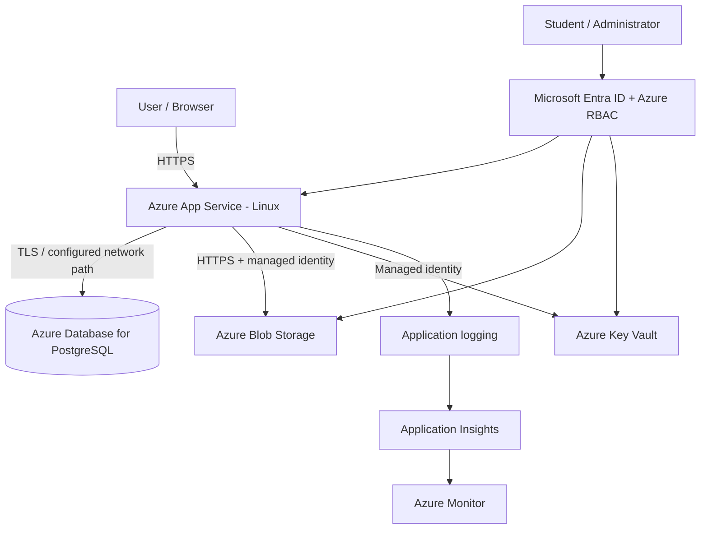

# Azure Cloud Infrastructure and Web Application Deployment

A beginner-friendly, hands-on Azure learning repository for a university student using an Azure Student Subscription.

This project focuses on **exactly three areas**:

1. Explore Azure cloud services: compute, object storage, managed databases, virtual networking, IAM/RBAC, and monitoring.
2. Manage cloud configuration securely: environment variables, secrets, application logging, and resource quotas.
3. Deploy a web application: application code → Azure compute → database/storage → networking → live application.

The practical application is **CloudTask**, a small task manager built with Python Flask, HTML, CSS, and JavaScript.

> **Important:** This is an educational starter project, not a production-ready application. Authentication, per-user authorization, hardened file uploads, database migrations, and other production controls must be added before real-world public use.

## Architecture



## Repository structure

```text
01-azure-cloud-services/          Learn and explore six Azure service areas
02-secure-cloud-configuration/    Environment variables, secrets, logs, quotas
03-cloud-web-application/          CloudTask source, database, storage, deployment
screenshots/                      Add your own redacted evidence
docs/                             Roadmap, architecture, costs, troubleshooting
```

## Start here

1. Read `docs/project-roadmap.md`.
2. Complete `01-azure-cloud-services/01-compute-services/`.
3. Continue one practical activity at a time.
4. Build and test CloudTask locally before creating additional Azure resources.
5. Add screenshots only after completing the activity yourself.

## Local application setup

Requirements: Python 3.10+, Git, and a code editor.

```bash
cd 03-cloud-web-application/application/backend
python -m venv .venv

# Windows PowerShell
.venv\Scripts\Activate.ps1

# macOS / Linux
# source .venv/bin/activate

pip install -r requirements.txt
```

Copy `.env.example` from the repository root to the root `.env` file, then set a unique local `SECRET_KEY`. From the backend directory, run:

```bash
flask --app app run --debug
```

Open `http://127.0.0.1:5000/`. The starter uses SQLite locally, so you can learn the application without first paying for a managed database.

Run tests:

```bash
pytest -q
```

## Student subscription cost warning

An Azure Student Subscription does **not** make every service free. App Service plans, PostgreSQL compute/storage, storage transactions and capacity, networking, Key Vault operations, and monitoring ingestion/retention may incur charges or consume student credit.

Before creating a resource:
- Check subscription credit and offer terms.
- Check regional service availability and quotas.
- Review the Azure pricing calculator and portal estimate.
- Choose a small development configuration only when available and appropriate.
- Understand which resources keep billing when an application is idle or stopped.
- Delete lab resources when finished, after saving evidence and required data.

Do not create paid resources without reviewing the estimate and confirming that you want to proceed.

## Security rules

- Never commit `.env`, passwords, connection strings, API keys, private keys, tokens, or secret values.
- Keep Blob containers private.
- Prefer managed identity and least-privilege RBAC for Azure-to-Azure access.
- Require HTTPS and database TLS.
- Never open PostgreSQL port 5432 to the whole internet.
- Do not log secrets or sensitive personal information.
- Remove sensitive identifiers from screenshots before uploading them.

## Progress tracking

Use the checklists in each practical activity. Mark an item complete only after you have performed and verified it in your own Azure environment.
